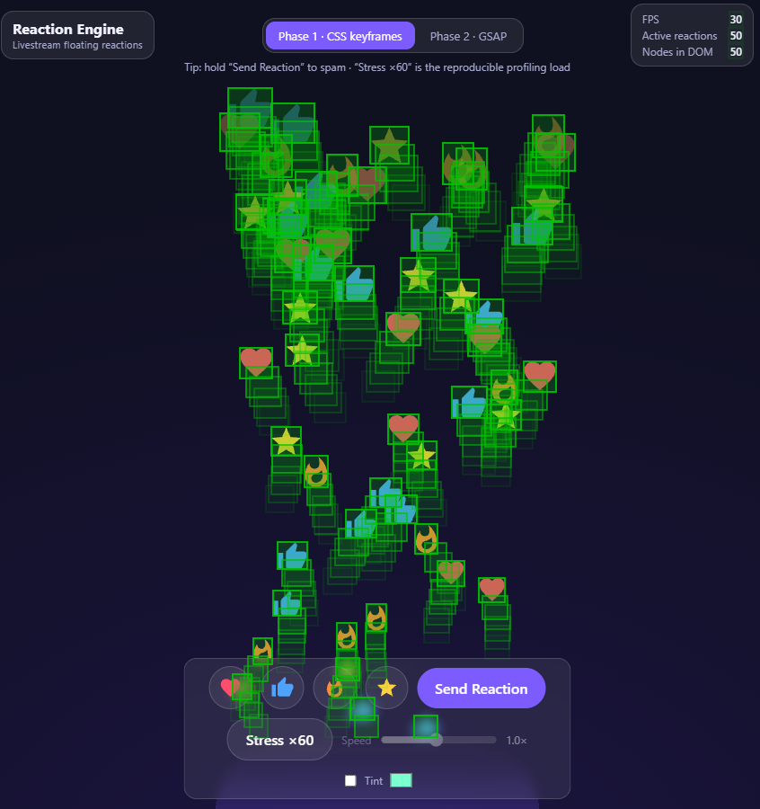

# Livestream Reaction Engine — Submission

A floating-reactions widget for live streams, built twice to compare how the browser renders each approach:

- **Phase 1:** DOM elements animated with pure CSS `@keyframes` on layout properties.
- **Phase 2:** the same elements animated with GSAP on GPU-composited properties only (`x`, `y`, `scale`, `opacity`).

Both phases animate the identical element, created by a shared factory, so the rendering cost is the only variable.

---

## 1. Setup & Running Instructions

There is no build step. The project is vanilla HTML, CSS and JavaScript. GSAP 3.12.5 is vendored in `vendor/`, so it runs offline.

```bash
# Option A: open index.html directly in Google Chrome (works from file://)
# Option B: serve the folder with any static server
npx serve .        # then open http://localhost:3000
```

Use the toggle at the top of the page to switch between **Phase 1 · CSS keyframes** and **Phase 2 · GSAP**. The mode can also be set from the URL with `?mode=css` or `?mode=gsap`.

### Controls

| Control | Behaviour |
|---|---|
| ❤️ 👍 🔥 ⭐ buttons | Spawn that specific reaction |
| **Send Reaction** | Spawns one random reaction on click; hold to spawn continuously |
| **Stress ×60** | Spawns 60 reactions 15 ms apart so all are airborne together (repeatable load for profiling) |
| **Speed** slider (Phase 2) | Sets `timeScale` from 0.1× to 2.0× on every reaction currently in flight |
| **Tint** checkbox + colour picker | Recolours all reactions at runtime, including those already flying |
| Live stats | FPS, active reactions, and the number of reaction nodes currently in the DOM |

### Features

- Reactions spawn from a defined area at the bottom of the viewport.
- Each reaction rises to the top over a 3-second lifespan, sways horizontally (two sine cycles), scales up, and fades out before reaching the top boundary.
- Each element is removed from the DOM when its animation completes (`animationend` in Phase 1, the timeline's `onComplete` in Phase 2). The *Nodes in DOM* counter returns to 0 once all reactions have finished.
- 50+ concurrent reactions are supported in both phases.
- Icons are inline SVG, so they stay sharp at any size.

### Project structure

```
index.html            Page markup and SVG icon sprite
css/styles.css        UI styles, Phase 1 @keyframes, static Phase 2 styles
js/icons.js           Shared element factory and spawn-position helper
js/engine-css.js      Phase 1 engine (CSS keyframes)
js/engine-gsap.js     Phase 2 engine (GSAP timelines)
js/app.js             Controls, mode switching, stress test, live stats
vendor/gsap.min.js    GSAP 3.12.5
docs/screenshots/     DevTools screenshots referenced below
bench/                Automated benchmark (supplementary, see Appendix A)
```

---

## 2. Phase 1: CSS Keyframes Analysis

**Profiling setup:** Google Chrome DevTools with Paint Flashing and Frame Rendering Stats enabled, CPU throttling at 6× slowdown, and 60 concurrent reactions generated with the **Stress ×60** button.

* **Paint Flashing Screenshot:**

  

* **Performance Profile Screenshot:**

  

* **Measurements (60 reactions, 6× CPU slowdown):**

  | Category | Time |
  |---|---|
  | Rendering (Layout + Recalculate Style) | 3,750 ms |
  | Painting | 819 ms |
  | Scripting | 512 ms |
  | Total | 5,988 ms |
  | Frame rate | ~30 FPS |

* **Observations:**
  * **Which regions flashed green, and why?** A large, continuous green area covers the entire column the reactions travel through, not just the icons themselves. The keyframes animate `bottom`, `margin-left`, `width` and `height`, all of which change an element's geometry. Each frame the browser must recompute layout, then repaint both the area the icon left and the area it now occupies. Because each icon also grows while it rises, its repaint region is larger than the icon, and 60 overlapping icons produce overlapping repaint regions on a shared layer. The whole flight path is therefore repainted on every frame.
  * **What did main-thread activity look like?** Rendering (Recalculate Style and Layout) was the dominant cost at 3.75 s, followed by Painting at 0.82 s. In the flame chart, every frame contains the full Recalculate Style → Layout → Pre-paint → Paint → Commit sequence, and frames crowd one another. Scripting is small (512 ms) because the animation itself runs in CSS, so nearly all of the main thread's time goes to the rendering pipeline. The frame rate dropped to about 30 FPS.

---

## 3. Phase 2: GSAP & Composited Rendering Analysis

**Implementation:** each reaction is a GSAP timeline that animates only `x`, `y`, `scale` and `opacity`. GSAP writes these as a single `translate3d(...) scale(...)` transform plus `opacity`, and each icon is promoted to its own compositor layer with `will-change: transform, opacity`. A range slider (0.1–2.0) sets `timeScale` on every in-flight timeline.

* **Performance Profile Screenshot:**

  

* **Paint Flashing Screenshot:**

  

* **Measurements (60 reactions, 6× CPU slowdown):**

  | Category | Phase 1 (CSS) | Phase 2 (GSAP) | Change |
  |---|---|---|---|
  | Rendering (Layout + Recalculate Style) | 3,750 ms | 1,070 ms | ~3.5× lower |
  | Painting | 819 ms | 143 ms | ~5.7× lower |
  | Scripting | 512 ms | 895 ms | ~1.75× higher |
  | Total | 5,988 ms | 2,283 ms | ~2.6× lower |
  | Frame rate | ~30 FPS | ~47 FPS | ~57% higher |

* **Observations:**
  * **How did the flame chart and frame rate change compared to Phase 1?** Total main-thread time fell from 5.99 s to 2.28 s. Rendering dropped by about 3.5× and Painting by about 5.7×, and the frame rate rose from roughly 30 to roughly 47 FPS. Scripting increased from 512 ms to 895 ms, because GSAP computes values in JavaScript on the main thread every frame. That increase is small compared with the rendering and painting time removed, so the net cost is considerably lower. The Rendering time that remains is chiefly style recalculation, since GSAP updates inline styles each frame, plus the work of inserting and removing nodes.
  * **What happened to the green paint-invalidation areas?** They largely disappeared. With each icon on its own compositor layer, moving, scaling or fading it only changes that layer's transform matrix and opacity. The icon's pixels are already painted, so the GPU re-composites the existing texture at its new position and nothing needs repainting.
  * **Slow motion at 0.1×:** dragging the slider to 0.1× while reactions are ascending slows all of them smoothly. `timeScale` changes the playback rate but preserves each timeline's playhead, so there is no jump or restart. Cleanup still runs correctly because each timeline's `onComplete` fires when it finishes, just later.
  * **A note on where the work runs:** GSAP drives the animation from JavaScript, so it is not a compositor-thread animation. Its advantage here is that it removes Layout and Paint from every frame while adding runtime control (speed changes, sequencing, values computed at spawn time). A fixed, fire-and-forget `transform`/`opacity` animation in pure CSS would run entirely on the compositor and be cheaper still.

---

## 4. Architectural Reflection

* **Runtime Control & Developer Experience:**
  A CSS keyframe rule is a static declaration. Per-element randomness has to be supplied through custom properties (`--x`, `--sway`) before the animation starts, and once it is running those values cannot change. Changing speed mid-flight would mean editing `animation-duration`, which restarts the animation or makes it jump, or reaching into every running animation through the Web Animations API one element at a time.
  A GSAP timeline is an object with a playhead. One call to `timeScale(v)` retimes it without a discontinuity, and the engine keeps a `Set` of in-flight timelines so a single slider event updates all of them. Timelines can also be paused, reversed, seeked, extended or killed from code, and their paths can be calculated at spawn time from live data such as viewport height or the current speed. The trade-offs are an extra library, per-frame JavaScript on the main thread, and animation logic that is no longer declarative CSS. For simple, fixed effects, CSS animations of `transform` and `opacity` remain the lighter choice.

* **Pipeline Considerations:**
  Pre-rendered raster sequences (PNG, GIF, sprite sheets or video) fix colour, shape and size in pixels. Supporting user preferences such as themes, brand colours or high-contrast modes would mean producing and shipping a variant of every sequence for each option, plus `@1x/@2x/@3x` versions to stay sharp across screen densities. Every frame is a bitmap that must be downloaded, decoded and held in memory, and runtime tinting through filters or blend modes is lossy and costly, and cannot recolour individual parts of the artwork.
  Vector assets are resolution-independent, small, and parametric. The icons here are SVG filled with `currentColor`, so a single CSS variable recolours every reaction instantly, including ones already in flight (the *Tint* control demonstrates this). Individual shapes can be restyled or morphed, assets can respond to dark mode or reduced motion, and animation is expressed as a few changing numbers rather than swapped frames. Two practical measures keep the vector approach fast: each icon is rendered at its largest size and scaled *down*, so a promoted layer is never upsampled and cannot blur, and animated layers avoid expensive paint effects such as filters and large shadows. Raster sequences remain appropriate for photographic or hand-painted artwork that cannot be expressed as vectors, ideally as a sprite sheet or video decoded off the main thread.

---

## Appendix A: Supplementary Automated Benchmark

The measurements in sections 2 and 3 come from manual DevTools recordings. As an additional, repeatable reference, `bench/bench.js` runs the same scenario automatically and records the results to `bench/results.json`.

**Method:** Playwright drives Chrome (v157, headless, software rendering) and uses the DevTools Protocol to apply the same **6× CPU throttling**. It triggers the same 60-reaction burst and reads the browser's performance counters and per-frame timings. Each mode is run three times and the **median** is reported. One run per mode also records a full trace (`bench/trace-css.json.gz`, `bench/trace-gsap.json.gz`) that can be opened in DevTools via *Performance → Load profile* after decompressing.

**Run it yourself:**

```bash
npm i playwright
node bench/bench.js
```

**Results (60 concurrent reactions, 6× CPU slowdown, median of 3 runs):**

| Metric | Phase 1 (CSS) | Phase 2 (GSAP) |
|---|---|---|
| Average FPS | 48.1 | 55.9 |
| Frames slower than 33 ms (of the run) | 19 | 6 |
| Layout time | 541 ms | 125 ms |
| Recalculate Style time | 1,248 ms | 845 ms |
| Script time | 71 ms | 922 ms |

**Trace event totals (one traced run per mode):**

| Event | Phase 1 (CSS) | Phase 2 (GSAP) |
|---|---|---|
| Paint events | 6,935 | 187 |
| Paint time | 592 ms | 57 ms |
| Layout events | 264 | 122 |
| Layout time | 537 ms | 124 ms |

**Reading the results:** the automated run shows the same pattern as the manual recordings. Phase 2 performs roughly 37× fewer paint operations (187 vs 6,935), about a quarter of the layout time, and a higher frame rate, while spending far more time in script because GSAP computes values in JavaScript each frame. The roughly 120 layouts remaining in Phase 2 are consistent with 60 nodes being inserted and 60 removed rather than with the animation itself.

**Why the absolute values differ from sections 2 and 3:** the automated run uses a different machine configuration (headless Chrome with software rendering and no GPU), a fixed measurement window, and medians across several runs, whereas the DevTools recordings are single manual captures on a different device. Absolute figures are therefore not directly comparable between the two. The relative differences between the phases are the meaningful result.
