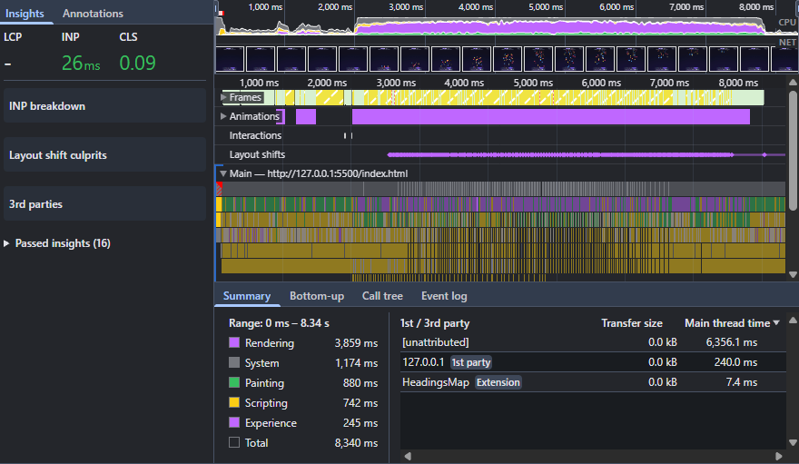
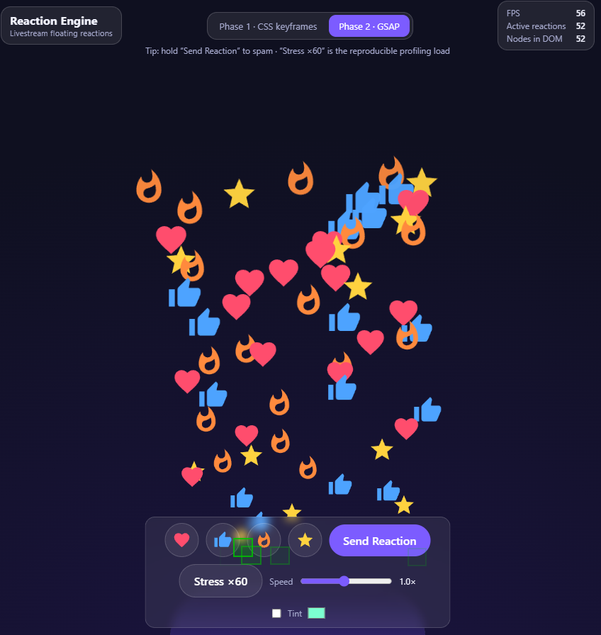
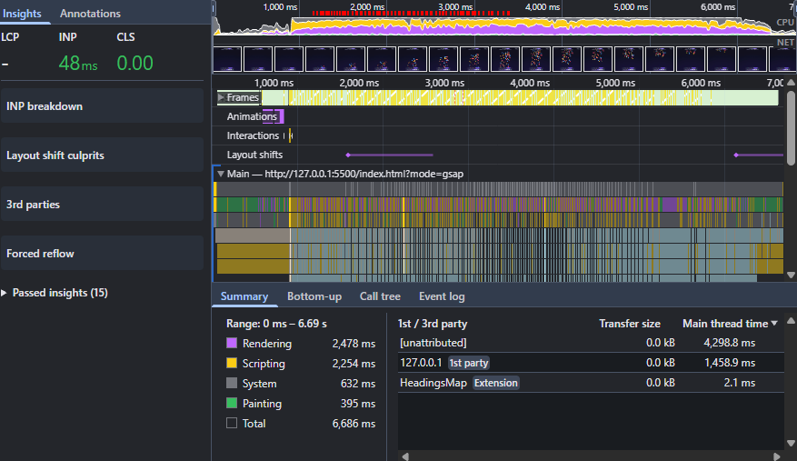

# Livestream Reaction Engine — Submission

> **Reference-run note:** the numbers and the two Paint Flashing screenshots below were captured with Chrome DevTools Protocol
> (`Emulation.setCPUThrottlingRate = 6`, Paint Flashing overlay on) by `bench/bench.js` in a headless, software-rendered Chrome.
> Absolute FPS on a real GPU laptop will differ; the *ratios and patterns* are what matter. Flame-chart screenshots are from
> loading the recorded traces (`bench/trace-css.json.gz`, `bench/trace-gsap.json.gz` — run `gunzip` first) into DevTools → Performance.

## 1. Setup & Running Instructions

No build step. Everything is vanilla HTML/CSS/JS; GSAP 3.12.5 is vendored in `vendor/` (works offline).

```bash
# Option A – just double-click index.html (works from file://)
# Option B – any static server:
npx serve .            # then open http://localhost:3000
```

Open in **Google Chrome**. Use the toggle at the top to switch engines (also `?mode=css` / `?mode=gsap`).

| Control | What it does |
|---|---|
| ❤️ 👍 🔥 ⭐ buttons | Spawn that specific reaction |
| **Send Reaction** | Spawns a random reaction; **hold** to spam (easy 50+ concurrent) |
| **Stress ×60** | Reproducible profiling load: 60 reactions, 15 ms apart (all alive at once during the 3 s lifespan) |
| **Speed** slider (Phase 2) | `timeScale` 0.1×–2.0× applied to every in-flight reaction in real time |
| **Tint** | Re-colours all reactions at runtime via one CSS variable (supports the Section 4 argument) |
| Live stats | FPS, active reactions, and **Nodes in DOM** (returns to 0 when idle → proves no zombie nodes) |

```
index.html            markup + SVG sprite (vector icons)
css/styles.css        shell · Phase 1 @keyframes (layout props) · Phase 2 static styles
js/icons.js           shared element factory (both engines animate the identical node → fair test)
js/engine-css.js      Phase 1
js/engine-gsap.js     Phase 2
js/app.js             wiring, stress test, stats
bench/bench.js        reproducible headless benchmark  ·  bench/results.json  ·  bench/trace-*.json
docs/                 screenshots + INTERVIEW_PREP.md
```

**Requirements checklist:** spawn area at bottom ✔ · 3 s upward flight ✔ · horizontal sway (2 sine cycles) ✔ · scale up ✔ · fade out before top ✔ ·
removed from DOM on completion (`animationend` / GSAP `onComplete`, verified: 60 → 0 nodes) ✔ · 50+ concurrent ✔.

## 2. Phase 1: CSS Keyframes Analysis

* **Paint Flashing Screenshot:** 
* **Performance Profile Screenshot:** 
  *(DevTools → Performance → Load profile → `bench/trace-css.json` after `gunzip`, 6× slowdown)*
* **Observations:**
  * **What regions flashed green, and why?** A huge, continuous green smear covers the *entire* column the reactions travel through
    — not just the icons. Each frame, `bottom`, `margin-left`, `width` and `height` change, which changes the element's **geometry**.
    Chrome must re-run Layout, then **re-paint the old position (to erase it) and the new position (to draw it)**. Because the box also
    grows every frame, the invalidated rectangle is larger than the icon itself, and 60 overlapping icons produce overlapping rectangles
    on a shared layer. The whole flight path is therefore repainted every frame.
  * **Main-thread activity (6× throttle, 60 concurrent, one 3 s run):**

    | Event | Phase 1 count | Phase 1 time |
    |---|---|---|
    | Layout | **264** | 537 ms |
    | Recalculate Style (UpdateLayoutTree) | 264 | 1 237 ms |
    | Paint | **6 935** | 592 ms |
    | PrePaint | 433 | 544 ms |

    In the flame chart every frame has the full **Recalculate Style → Layout → Pre-paint → Paint → Layerize/Commit** stack on the main
    thread, and frames visibly crowd each other. Layout count tracks the number of frames; it is driven by the animation itself.
  * **Frame rate:** ~48 FPS median (44.6–49.2 over 3 runs), p95 frame 33 ms, worst frame 67–83 ms, 19–22 frames over 33 ms at 6× slowdown.

## 3. Phase 2: GSAP & Composited Rendering Analysis

* **Paint Flashing Screenshot:** 
* **Performance Profile Screenshot:** 
  *(DevTools → Performance → Load profile → `bench/trace-gsap.json` after `gunzip`, 6× slowdown)*
* **Observations:**
  * **Flame chart / frame rate vs Phase 1** (same load, same throttle, median of 3 runs):

    | Metric | Phase 1 CSS | Phase 2 GSAP |
    |---|---|---|
    | Avg FPS | ~48 (44.6–49.2) | **~56** (55.4–58.5) |
    | Paint events (1 run) | 6 935 | **187** |
    | Paint time | 592 ms | **57 ms** |
    | Layout events | 264 | **122** |
    | Layout time | 537 ms | **124 ms** |
    | Frames > 33 ms | 19–22 | **1–8** |
    | Nodes left after run | 0 | 0 |

    Paint effectively disappears from the per-frame work, and Layout drops by more than half. The remaining ~120 layouts do **not**
    scale with frame count; they are consistent with node insertion (60) + removal (60) rather than with animation.
  * **Paint invalidation areas:** the green smear is gone. With `will-change: transform, opacity` each icon sits on its own compositor
    layer; moving it only changes that layer's transform matrix, so there is nothing to re-paint — the GPU just re-composites the existing
    textures at new positions. Any green is limited to a node's first paint when it is inserted.
  * **Honest caveat (important for the interview):** GSAP is *JavaScript on the main thread*. Each frame it computes values and writes
    `transform`/`opacity` inline, so Script time goes **up** (~700–950 ms vs ~50–70 ms) and Recalculate Style remains (~435 events).
    What it removes is Layout + Paint *per frame*. A pure-CSS animation of `transform`/`opacity` would run fully on the compositor thread
    and be even cheaper — GSAP is chosen here because it gives runtime control (timeScale, sequencing, dynamic values).
  * **0.1× slow motion:** with the slider at 0.1× while 60 reactions are mid-flight, the playheads keep their positions (no jump) and
    all motion continues smoothly at one-tenth speed. Cleanup still happens because `onComplete` fires when each timeline finishes, just later.

## 4. Architectural Reflection

* **Runtime Control & Developer Experience:**
  A CSS keyframe rule is a *static declaration*. To change speed mid-flight you would have to edit `animation-duration`, which restarts or
  jumps the animation from a new computed position, and you cannot reach into 60 running animations at once without touching each element
  (or using the Web Animations API directly). Randomised paths need CSS custom properties (`--x`, `--sway`) set *before* start; once
  running they are fixed, and per-element sequencing means more generated rules.
  A GSAP timeline is an *object with a playhead*: one `timeScale(v)` call retimes the animation without discontinuity (here: a `Set` of
  in-flight timelines, updated from one slider event), and you can pause, reverse, seek, add tweens or kill it in code. Paths can be
  computed per spawn from live data (viewport height, current speed, user state). The trade-offs: extra JS payload, main-thread cost per
  frame, and the animation is no longer declarative/inspectable in CSS — so for simple, fixed, fire-and-forget effects CSS
  transform/opacity animations are still the lighter choice.

* **Pipeline Considerations:**
  Pre-rendered raster sequences (PNG/GIF/sprite sheets/video) bake colour, shape and size into pixels. Re-theming means shipping and
  loading a variant of every sequence per theme/colour/locale (N assets × M themes), and runtime tinting (blend modes, filters, canvas
  recolouring) is lossy, costs GPU/CPU, and can't recolour individual parts. Rasters also need `@1x/@2x/@3x` variants to stay sharp
  at different DPRs and zoom levels, add bandwidth, decode time and memory (every frame is a bitmap).
  Vector assets (SVG with `currentColor` or CSS variables, or Lottie-style vector data) are **resolution independent**, tiny, and
  **parametric**: one asset can be re-tinted by changing a CSS variable (see the *Tint* control, which recolours every in-flight
  reaction instantly), have individual shapes restyled or morphed, respond to user preference (dark mode, high contrast, reduced motion),
  and animate by changing a few numbers instead of swapping frames. Practical rules we applied: rasterise the vector at its
  *largest* size and scale *down* (so a compositor-promoted layer is never upsampled → no blur), keep the node count/complexity low,
  and avoid expensive paint effects (filters, big shadows) on animated layers. Raster sequences remain justified when art is photographic
  or hand-painted and can't be expressed as vectors — then prefer a sprite sheet/video decoded off the main thread.

## 5. Submission checklist

- [x] Phase 1 and Phase 2 functional and easy to test (toggle + Stress ×60 button)
- [x] DevTools screenshots for both phases (paint flashing included; add your own flame-chart screenshots at `docs/screenshots/phase{1,2}-performance.png`)
- [x] All floating elements removed on completion (Nodes in DOM counter returns to 0; verified 60 → 0 in both modes)
- [x] All reflection questions answered
# EA-reaction-system

